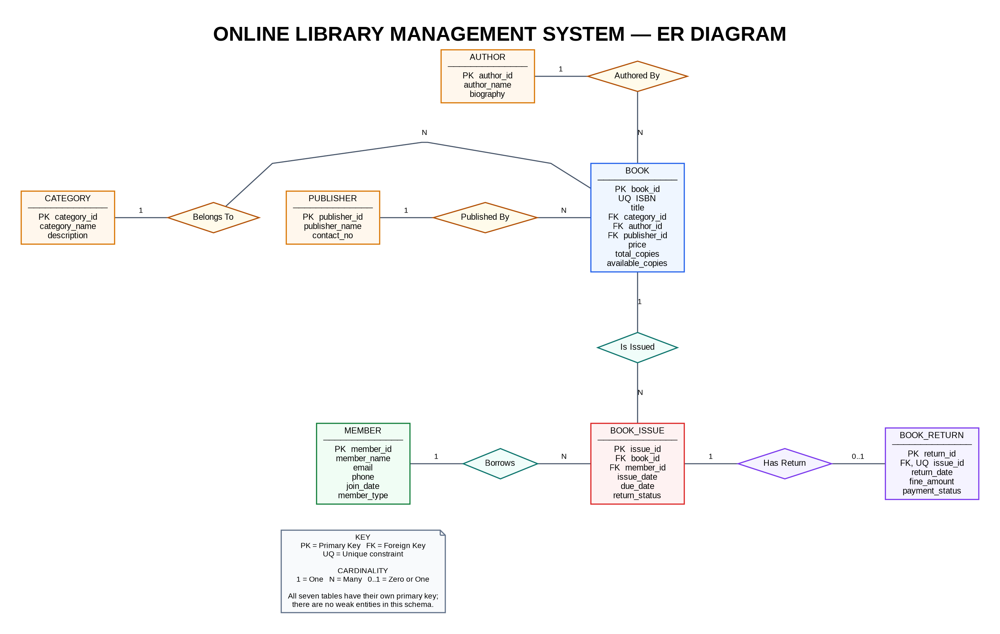

# Online Library Management System — Weekly SQL Work

An organized weekly MySQL implementation of an Online Library Management System, covering schema design (ERD), DDL, DML, TCL, aggregate functions, and relational joins.

## Entity Relationship Diagram (ERD)

## Weekly Syllabus & Progress

| Week | Topic |
|---|---|
| Week 1 | Database and table creation (DDL) |
| Week 2 | Insert sample data |
| Week 3 | UPDATE, DELETE and transaction control |
| Week 4 | Basic SQL queries and data retrieval |
| Week 5 | Aggregate functions and date-based queries |
| Week 6 | SQL operators, joins and set operations |

## How to run

1. Open MySQL Workbench.
2. Run Week 1 first to create the database and tables.
3. Run Week 2 to insert sample records.
4. Run Weeks 3–6 for the corresponding exercises.

Weeks 3–6 depend on the database and sample data created in Weeks 1 and 2.

## Scope

Only Weeks 1–6 are included because these are the weeks completed so far. Subqueries and later topics are intentionally excluded for now.

**Database:** `LibraryManagement_db`  
**SQL dialect:** MySQL / MySQL Workbench
